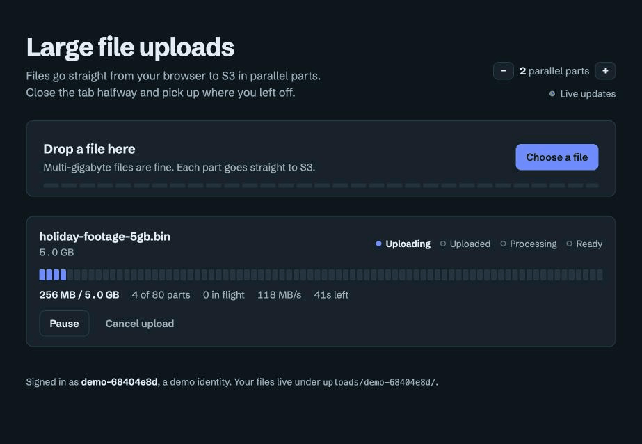
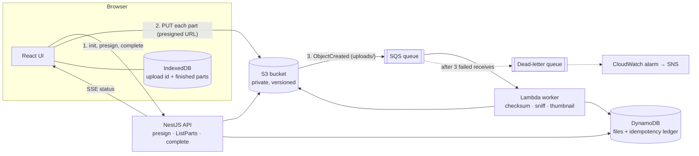
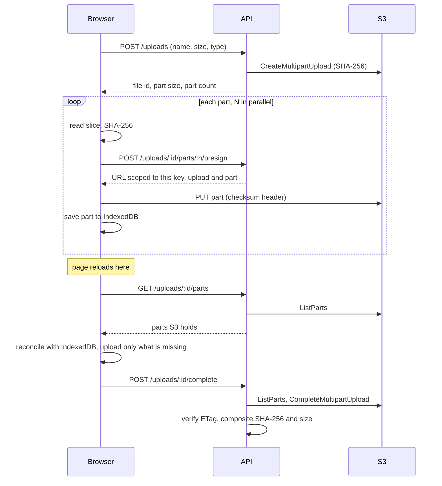

# s3-upload-pipeline

[](https://github.com/kevinmakwana/s3-upload-pipeline/actions/workflows/ci.yml)
[](LICENSE)

Upload files of many gigabytes **straight from the browser to S3**, survive a page refresh halfway through, and have them processed asynchronously. The API only hands out presigned URLs; file bytes never pass through it.

It runs entirely on your machine against [LocalStack](https://www.localstack.cloud/). No AWS account is needed, and the very same CDK stack deploys to real AWS if you want it to.



*A 5 GB file, uploaded with 2 parallel parts. The page is refreshed at 28 of 80 parts and carries straight on, then S3 verifies the file and the worker checksums it.*

## What it does

- **Multipart upload from the browser.** The API plans the parts (64 MiB by default, growing as needed to respect S3's 10,000-part limit), signs one URL per part, and the browser uploads them in parallel with a configurable concurrency.
- **Per-part retry with backoff.** Each attempt re-reads, re-hashes and re-signs, so an expired URL or a corrupted transfer is just another retry.
- **Resume across reloads.** The upload id and finished parts live in IndexedDB. On reload the browser asks the API for `ListParts`, reconciles it with what it remembers, and uploads only what is missing. In Chromium the file handle is stored too, so it continues with no file picker at all; elsewhere you re-select the same file.
- **Integrity end to end.** Every part carries a SHA-256 that S3 itself verifies. When completing, the API rechecks the part list, then compares the final ETag and composite SHA-256 with values recomputed from the parts, and deletes the object if they disagree.
- **Async processing.** `ObjectCreated` → SQS → Lambda. The worker streams the object to compute a SHA-256, sniffs the real content type, reads image dimensions and writes a thumbnail, then records the result.
- **Safe to retry.** Processing is idempotent per `object key + version`, backed by a DynamoDB lease, so duplicate deliveries do no extra work and a crashed worker's lease simply expires. Failures retry, then land in a DLQ that raises a CloudWatch alarm.
- **Live status.** A file moves through `uploading → uploaded → processing → ready | failed`, pushed to the UI over server-sent events. With malware scanning on, an infected file ends as `quarantined` instead (see [Malware scanning](#malware-scanning)).

## Architecture



### Upload and resume



### Security

- Presigned URLs are scoped to **one key, one upload id and one part number**, expire in 15 minutes (configurable, capped at 1 hour), and sign the part's `Content-Length` and `x-amz-checksum-sha256`.
- Every object lives under its owner's prefix, `uploads/<user>/<file id>/…`. File names are sanitised so they cannot escape it, and every API call checks ownership (someone else's upload looks exactly like a missing one).
- The bucket blocks all public access, enforces TLS, encrypts at rest and is versioned. CORS allows only the configured origins.
- Per-user quotas (uploads in progress, bytes held) are checked before anything is created in S3, and requests are rate limited per client address and per credential; over the limit is a `429` with `Retry-After`. The health check is never limited. Counters are in memory, so with several API tasks each enforces its own share. The quota check and the create are not atomic, so racing requests can overshoot slightly: these guard cost, they are not a ledger.
- Responses carry the standard hardening headers (Helmet).
- Allowed types and a maximum size are validated by the API before anything is created, and again by the worker, which rejects content that does not match its declared type (a ZIP renamed `.png` ends up `failed`).
- IAM is least privilege and checked by tests: the worker may read `uploads/*`, write `thumbnails/*` and use two DynamoDB actions; the API gets a separate managed policy with only what it calls (including deleting versions under `uploads/*` and `thumbnails/*`, and listing versions only for those two prefixes).

### Authentication

A global guard ([`auth.guard.ts`](apps/api/src/auth/auth.guard.ts)) authenticates every route except `/health` and hands the rest of the API a `userId`. Two modes, chosen by `AUTH_MODE`:

- **`jwt`** verifies a `Authorization: Bearer <token>` from your identity provider (Auth0, Cognito, Entra ID, Keycloak, anything that publishes a JWKS). It checks the signature, issuer, audience and expiry, accepts asymmetric algorithms only, and derives the user id from a hash of issuer and subject, so it is always safe inside an S3 key prefix.
- **`header`** (the default, for the local demo only) trusts an `x-user-id` header, so anyone can claim to be anyone. With `NODE_ENV=production` the API **refuses to start** in this mode unless `ALLOW_INSECURE_DEMO_AUTH=true`.

The web app mirrors this with `VITE_AUTH_MODE`. In `bearer` mode it calls `window.s3upAuth.getToken()` before every request and every SSE connect, so your login code can refresh tokens there:

```html
<script>
  window.s3upAuth = { getToken: async () => myLoginLibrary.getAccessToken() };
</script>
```

On AWS you can bring your own identity provider or let the stack create a Cognito user pool (see [Sign-in with Cognito](#sign-in-with-cognito)). The web app can also sign users in itself: when its `/config.json` has an `oidc` section it runs the authorization code flow with PKCE against the hosted login page, sends the **ID token** to the API (its audience is the app client, which is what the API checks), refreshes it shortly before it expires, and shows a *Sign out* button. Tokens are kept in `sessionStorage`, so they disappear with the tab; the CloudFront deployment's Content-Security-Policy is what keeps foreign scripts away from them.

## Quick start (LocalStack, no AWS account)

You need Node 22+ and Docker.

```bash
npm install

npm run localstack:up        # starts LocalStack in Docker
npm run localstack:deploy    # deploys the real CDK stack into it, writes .env.local

npm run dev                  # API on :3001, web on :5173
```

Open <http://localhost:5173>. To try a big file, generate one and choose it:

```bash
npm run gen:file -- ~/big.bin 5120     # 5 GiB of random data
```

Then upload it, **refresh the page while it is going**, and carry on. In Chromium it resumes by itself; in other browsers click *Choose file to resume* and pick the same file.

Stop everything with `npm run localstack:down`.

> **LocalStack version.** `docker-compose.yml` pins `localstack/localstack:4.14.0`. LocalStack images from 2026.03 onward need an auth token; 4.14.0 is the last community release that runs without one. Everything here deploys to it unchanged.

## What was actually run

| Check | Result |
| --- | --- |
| Browser (Chrome) → API → LocalStack, 3 GB file | uploaded, verified, processed, `ready` |
| Browser, 5 GB file with a mid-upload page refresh | resumed from 28/80 parts, `ready`, SHA-256 shown |
| `npm run soak -- 15`: 15 GiB synthetic file, interrupted at 40% and resumed from a fresh session | 240 parts; resumed from 97/240; the Lambda's SHA-256 matched the locally computed one (about 6 minutes end to end) |
| `npm run test:integration` (200 MB generated file, interrupted and resumed) | 22 tests pass against LocalStack |

Throughput on a laptop against LocalStack was roughly 150 to 270 MB/s. That says nothing about real S3; it only shows the logic holds at size.

## Configuration

Environment variables for the API (the quick start writes `.env.local` for you; see [`.env.example`](.env.example)):

| Variable | Default | Purpose |
| --- | --- | --- |
| `BUCKET_NAME`, `TABLE_NAME` | required | From the stack outputs |
| `PART_SIZE_BYTES` | 64 MiB | Preferred part size. Grows automatically to stay under 10,000 parts, and never goes below S3's 5 MiB minimum |
| `MAX_FILE_SIZE_BYTES` | 20 GiB | Reject larger files up front |
| `PRESIGN_EXPIRES_SECONDS` | 900 | Lifetime of part URLs (clamped to 60..3600) |
| `CORS_ORIGINS` | `http://localhost:5173` | Browser origins the API accepts |
| `S3_PUBLIC_ENDPOINT` | unset | Only if the browser reaches S3 at a different URL than the API does |
| `AUTH_MODE` | `header` | `jwt` to verify bearer tokens, `header` for the insecure local demo (see [Authentication](#authentication)) |
| `JWT_ISSUER`, `JWT_AUDIENCE`, `JWT_JWKS_URL` | required with `AUTH_MODE=jwt` | Expected `iss` and `aud`, and the https URL of the issuer's JWKS |
| `DOWNLOAD_URL_EXPIRES_SECONDS` | 300 | Lifetime of download links (clamped to 60..3600) |
| `MAX_ACTIVE_UPLOADS_PER_USER` | 10 | Uploads one user may have in progress; more is a `409`. `0` turns it off |
| `MAX_STORED_BYTES_PER_USER` | 100 GiB | Bytes one user may hold (uploads in progress plus finished files); a file that would go over is a `413`. `0` turns it off |
| `RATE_LIMIT_IP_PER_MINUTE` | 1200 | Requests per client address, counted before authentication |
| `RATE_LIMIT_USER_PER_MINUTE` | 1500 | Requests per credential (bearer token or demo user id). Presigning one URL per part is most of this |
| `RATE_LIMIT_INIT_PER_MINUTE` | 30 | Uploads one credential may start per minute |
| `LOG_LEVEL` | `info` | `debug`, `info`, `warn`, `error` or `silent` |
| `TRUST_PROXY_HOPS` | 0 | Proxies in front of the API whose `X-Forwarded-For` to trust. The AWS stack sets `1` for its load balancer |
| `MALWARE_SCAN` | unset | `true` when the stack scans uploads: downloads then wait for a clean GuardDuty verdict. The stack sets it; leave it off for LocalStack |
| `ALLOW_INSECURE_DEMO_AUTH` | unset | Set to `true` to let `AUTH_MODE=header` start with `NODE_ENV=production`. Do not |

Web app: `VITE_API_URL` (API base URL) and `VITE_AUTH_MODE` (`demo`, the default, or `bearer`) apply at build time. A hosted deployment publishes `/config.json` instead (`apiUrl`, and `auth` as `{"mode":"demo"}` or an `oidc` section), which wins over the build-time values, so one build serves any deployment. A `config.json` that is present but invalid stops the app with a message instead of guessing.

Concurrency is a setting in the UI (1 to 16 parallel parts, remembered in `localStorage`). Allowed types live in [`packages/core/src/validation.ts`](packages/core/src/validation.ts).

### API

All routes except `/health` require authentication: a bearer token in `jwt` mode, or `x-user-id` in the local demo mode.

| Route | Purpose |
| --- | --- |
| `POST /uploads` | Validate, plan parts, open the multipart upload |
| `POST /uploads/:id/parts/:n/presign` | Presigned PUT for part `n` (body: base64 SHA-256 of the part) |
| `GET /uploads/:id/parts` | `ListParts` from S3, used to reconcile on resume |
| `POST /uploads/:id/complete` | Verify and complete (idempotent) |
| `DELETE /uploads/:id` | Abort and free the stored parts |
| `GET /files?limit=&cursor=` | One page of your files, newest first (`limit` 1 to 100, default 50). The response is `{ files, nextCursor? }`; pass `nextCursor` back as `cursor` for the next page. Aborted uploads are left out. A malformed cursor is a `400` |
| `GET /files/:id` | File status and processing result |
| `GET /files/:id/download` | A short-lived presigned link (5 minutes by default) to the original file, served as an attachment under its own name and pinned to the verified version. Only for `ready` files; anything else is a `409`. With malware scanning on, also a `409` until the exact stored version carries a clean verdict |
| `DELETE /files/:id` | Permanently delete a `ready`, `failed` or `quarantined` file: every stored version of the object and of its thumbnail, then the record. A file that is uploading or being processed is a `409`. If S3 refuses, the record is kept and the request can be retried |
| `GET /files/stream` | SSE stream of the newest page (`{ files, nextCursor? }`); older pages come from `GET /files` |

## Testing

```bash
npm test                  # unit tests
npm run typecheck
npm run lint              # ESLint; `npm run format:check` checks Prettier
npm run test:integration  # needs LocalStack up and deployed (see quick start)
npm run test:e2e          # Chromium against the dev servers and LocalStack (same prerequisites)
npm run smoke:aws         # real AWS only, on purpose (see Smoke test on AWS)
```

- **Unit** covers part and part-count planning at the S3 limits, key and prefix scoping, presign scoping (the signed URL's path, upload id, part number, expiry and signed headers), resume reconciliation, the upload engine (concurrency, backoff, pause, resume, restart when the upload expired), the worker's idempotency and failure handling, IAM least privilege on the synthesized template, IndexedDB persistence, and the HTTP API including cross-user isolation.
- **Integration** boots the real API against the deployed stack in LocalStack and uploads a generated ~200 MB file, interrupts it, resumes it from a fresh session, then waits for the Lambda to mark it `ready` and checks the checksum. It also covers thumbnails, content-type rejection, S3 refusing mismatched checksums, abort, and redelivery of the same S3 event. The DynamoDB store runs the same contract suite as its in-memory twin.
- **End-to-end** ([`e2e/`](e2e)) drives the real page in Chromium with Playwright. It starts the API and the Vite dev server itself (or reuses ones already running) and talks to the deployed stack in LocalStack. It uploads a three-part file and checks the worker's SHA-256, the downloaded bytes and the delete; uploads an image and checks its dimensions and thumbnail; interrupts a five-part upload with a reload and resumes it; and walks through the sign-in redirect with PKCE (against a stand-in login page), checking the ID token reaches the API and that signing out clears it. Run `npx playwright install chromium` once first.
- **Lint and format.** ESLint 10 (typescript-eslint, with the type-aware promise rules, and the React hooks rules for the web app) and Prettier. A pre-commit hook (husky and lint-staged) fixes staged files; CI fails on any lint error or unformatted file. `.git-blame-ignore-revs` lists the one-time reformat commit (`git config blame.ignoreRevsFile .git-blame-ignore-revs`).
- **TypeScript 7.** `tsc` is TypeScript 7 (`@typescript/native` in `package.json`). ESLint and ts-jest still need the JavaScript compiler API, which TypeScript 7 does not have, so the package named `typescript` is the TypeScript 6 API package (`@typescript/typescript6`), as Microsoft describes for [running side by side](https://devblogs.microsoft.com/typescript/announcing-typescript-7-0/). The Jest config therefore sets `ignoreDeprecations` for `node10` module resolution, which the CommonJS test run still uses. Drop the alias once typescript-eslint and ts-jest support TypeScript 7 directly.
- **CI** ([`.github/workflows/ci.yml`](.github/workflows/ci.yml)) runs lint, formatting, typecheck, unit tests, builds and `cdk synth` on Ubuntu 24.04, and runs the integration and browser suites with LocalStack as a service container. LocalStack does not enforce presigned-URL signatures, so signature scoping is verified on the generated URLs rather than by S3 refusing them.

## Deploy to real AWS (optional)

The stack is the same one the quick start uses. Locally it is deployed with `-c local=true` (disposable resources, no Fargate); for AWS you also pass `-c deployApi=true` to run the API on Fargate behind an Application Load Balancer.

```bash
cd infra
npx cdk bootstrap                      # once per account and region
npx cdk deploy -c deployApi=true \
  -c allowedOrigins=https://app.example.com \
  -c jwtIssuer=https://your-tenant.auth0.com/ \
  -c jwtAudience=https://upload-api.example.com \
  -c jwtJwksUrl=https://your-tenant.auth0.com/.well-known/jwks.json \
  -c certificateArn=arn:aws:acm:...    # recommended: HTTPS on the ALB
```

`deployApi` needs an auth choice: the three `jwt*` values, which become `AUTH_MODE=jwt` and `JWT_*` on the container. Without them `cdk deploy` stops with an error rather than shipping an API that would refuse to start. (`-c insecureDemoAuth=true` exists for throwaway experiments; it lets anyone act as any user.)

The outputs include the API URL. You can host the static files anywhere (build with `VITE_API_URL=https://api.example.com npm run build -w @s3up/web`), or let the stack do it (see [Hosting the web app](#hosting-the-web-app)). Browsers on an HTTPS site cannot call an HTTP API, so pass `certificateArn` for anything real. With your own hosting, build with `VITE_AUTH_MODE=bearer` and provide `window.s3upAuth` (see [Authentication](#authentication)).

Everything below is optional and off by default. Each is a CDK context value, and `npm run synth:full` (run in CI) synthesizes all of them together:

| Context | Adds |
| --- | --- |
| `-c cognito=true` (`-c cognitoSelfSignUp=true`) | A Cognito user pool, hosted login and app client; the API's JWT settings point at it. Use instead of the three `jwt*` values |
| `-c deployWeb=true -c apiDomain=api.example.com` | The web app on S3 and CloudFront |
| `-c malwareScan=true` | GuardDuty malware scanning of every upload, with quarantine |
| `-c apiMaxTasks=N` | Ceiling for API autoscaling (default 4) |

Cognito, CloudFront and GuardDuty do not exist in LocalStack, so the stack refuses them with `-c local=true`.

### Sign-in with Cognito

`-c cognito=true` creates a user pool (email sign-in, 12-character passwords, deletion protection on AWS), a hosted login page on `<stack>-<account>.auth.<region>.amazoncognito.com`, and one public app client that can use only the authorization code flow with the `openid` and `email` scopes. The API is deployed with `AUTH_MODE=jwt`, the pool as issuer, the client id as audience and the pool's JWKS, so nothing needs passing to it by hand. Accounts are created by you (Cognito console or CLI) unless you add `-c cognitoSelfSignUp=true`, which lets anyone register: think about that before turning it on, together with the per-user quotas in the table above.

Callback and sign-out URLs are your `allowedOrigins` (each with a trailing `/`) plus the CloudFront address when the web app is hosted. The default origin is `http://localhost:5173`, which Cognito accepts for development; pass only your real origin to drop it. Cognito's tokens are signed with RS256 and the API accepts nothing else. Access tokens have no `aud` claim, so the web app sends the ID token.

### Hosting the web app

`-c deployWeb=true -c apiDomain=api.example.com` serves the built app (run `npm run build -w @s3up/web` first) from a private bucket through CloudFront with origin access control:

- HTTPS only (HTTP redirects), HTTP/2 and 3, compression, price class 100, and single-page-app fallbacks (403 and 404 answer with `index.html`).
- `index.html` and `config.json` are never cached; everything else is cached for good (file names are hashed), and each deployment invalidates the CDN.
- Security headers: HSTS for two years, `nosniff`, `X-Frame-Options: DENY`, a strict referrer policy and a Content-Security-Policy that allows scripts only from the app itself and connections only to the API host, S3 and Cognito.
- The distribution's address is added to the upload bucket's CORS rules, to the API's allowed origins and to the Cognito client's callback URLs automatically.
- `config.json` is generated by the stack from the real API host and Cognito values.

`apiDomain` is the host name the API answers on; point a CNAME at the load balancer and make sure `certificateArn` covers it. The page is HTTPS, so the stack refuses `deployWeb` together with `deployApi` unless `certificateArn` is given. Without a custom domain on the distribution, CloudFront's own certificate allows TLS 1.0 clients; attach your own domain and certificate for a TLS 1.2 minimum.

### Malware scanning

`-c malwareScan=true` turns on [GuardDuty Malware Protection for S3](https://docs.aws.amazon.com/guardduty/latest/ug/gdu-malware-protection-s3.html) for everything under `uploads/` (it handles objects far larger than a Lambda could scan, and needs no GuardDuty detector). Costs are per GB scanned, so look at the GuardDuty pricing page first.

1. GuardDuty scans each new object and tags the exact version with `GuardDutyMalwareScanStatus` (`NO_THREATS_FOUND`, `THREATS_FOUND`, `UNSUPPORTED`, `ACCESS_DENIED` or `FAILED`).
2. The result also arrives on EventBridge. A handler checks it, and for `THREATS_FOUND` marks the file **`quarantined`** first (final: nothing moves it back), then deletes every stored version of the object and its thumbnail. If the delete fails the event is retried with the file already unreachable; after the retries it lands in a dead-letter queue that raises an alarm. A separate rule publishes every threat to the alarm topic.
3. The API serves a download only when the tag on the version it would hand out says `NO_THREATS_FOUND`. No tag yet means the scan is still running (`409`, try again in a minute); any other verdict is a `409` too, and **files GuardDuty cannot scan (for example password-protected archives) cannot be downloaded**. If the tags cannot be read, the request fails rather than letting the file through.

The worker still processes a file while it is being scanned, so an infected image may briefly get a thumbnail; quarantine deletes it. A quarantined file stays in the list with the reason until its owner deletes the record, and it no longer counts against the storage quota.

GuardDuty needs the bucket to send events to EventBridge; the stack enables that in the template itself, next to the queue notification, so CloudFormation does not drift.

### Deploying from GitHub Actions with OIDC

[`.github/workflows/deploy.yml`](.github/workflows/deploy.yml) is manual and **disabled by default**. It authenticates with GitHub's OIDC provider, so no AWS keys are stored in the repository. It works in two steps so nothing ships unseen:

1. **Plan.** The workflow synthesizes the stack once and runs `cdk diff` against what is deployed. The diff is in the run's summary page, and the synthesized plan is kept as an artifact.
2. **Deploy.** This job waits for a reviewer to approve the `aws-deploy` environment, then deploys *that same plan*, not a fresh synthesis, so what was reviewed is what ships. There is no blanket `--require-approval never`: changes that widen IAM permissions or network access make the deploy refuse to run unless you ticked **approve_security_changes** when starting it. A first deploy always counts, because it creates the roles. Tick **plan_only** to stop after the diff.

To enable it:

1. In IAM, add the OIDC identity provider `token.actions.githubusercontent.com` (audience `sts.amazonaws.com`).
2. Create a role that trusts it. Use the `sub` claim your repository actually emits ([how to check](https://github.com/aws-actions/configure-aws-credentials#quick-start-oidc-recommended)), for example:
   ```json
   {
     "Effect": "Allow",
     "Principal": { "Federated": "arn:aws:iam::<ACCOUNT_ID>:oidc-provider/token.actions.githubusercontent.com" },
     "Action": "sts:AssumeRoleWithWebIdentity",
     "Condition": {
       "StringEquals": {
         "token.actions.githubusercontent.com:aud": "sts.amazonaws.com",
         "token.actions.githubusercontent.com:sub": [
           "repo:kevinmakwana/s3-upload-pipeline:environment:aws",
           "repo:kevinmakwana/s3-upload-pipeline:environment:aws-deploy"
         ]
       }
     }
   }
   ```
3. Give the role permission to assume the CDK bootstrap roles (`sts:AssumeRole` on `arn:aws:iam::<ACCOUNT_ID>:role/cdk-*`), which keeps its own permissions tiny.
4. In the repository settings, create two environments: `aws` (for the plan; no approval needed) and `aws-deploy` with **required reviewers** (that approval is the gate). Then set the variables `AWS_DEPLOY_ROLE_ARN`, `AWS_REGION` and `ENABLE_AWS_DEPLOY=true`.
5. Run **Deploy to AWS (manual)** from the Actions tab and fill in the allowed origins and either the JWT issuer, audience and JWKS URL or the `cognito` option. The other options above are checkboxes there too; with `deploy_web` the workflow builds the web app first. A good first run is with **plan_only** ticked: read the diff, then run again with **approve_security_changes** if it widens permissions.

### Smoke test on AWS

LocalStack is not AWS: it does not enforce IAM and only imitates S3. `npm run smoke:aws` runs a short end-to-end check against a stack that is really deployed, using the real API code in-process:

```bash
cd infra && npx cdk deploy -c deployApi=true ... --outputs-file ../cdk-outputs.aws.json && cd ..
AWS_REGION=us-east-1 npm run smoke:aws
```

It uploads an 11 MiB file in three parts and checks the worker's SHA-256 and a byte-for-byte download, makes a thumbnail from a PNG, and deletes a file and checks its link dies. It creates a throwaway IAM role that carries **only the stack's `ApiPolicy`**, assumes it, and runs the API as that role, so a permission the API needs but the policy lacks fails here instead of on the first real upload (set `SMOKE_FULL_ACCESS=true` to skip this). The role is deleted afterwards. With `SMOKE_MALWARE=true` (stack deployed with `-c malwareScan=true`) it also uploads the harmless [EICAR test file](https://www.eicar.org/download-anti-malware-testfile/) and expects it to be quarantined, and checks downloads wait for a clean verdict; GuardDuty can take a few minutes. Files it creates are deleted at the end.

The calling identity needs `iam:CreateRole`, `AttachRolePolicy`, `DetachRolePolicy` and `DeleteRole` (on `role/s3up-smoke-*`), `sts:AssumeRole` on that role, and read access to the stack's resources. There is also a manual **Smoke test on AWS** workflow (disabled unless `ENABLE_AWS_DEPLOY=true`, like the deploy one) that reads the outputs from CloudFormation.

It has not been run in CI against a real account for you: that needs your account, so the first run is yours.

### Cost notes

Rough figures for `us-east-1`; prices change, so check the AWS pricing pages before relying on them.

- **While the API runs on Fargate, the baseline is roughly $30 to $35 a month**: the load balancer is the largest part (about $16 plus public IPv4 addresses), then a 0.25 vCPU / 0.5 GB task (about $9). There is no NAT gateway; tasks sit in public subnets and only the load balancer accepts traffic. Run `npx cdk destroy` when you are done experimenting.
- **Per upload it is pennies**: S3 storage (about $0.023 per GB-month) and request charges for a few hundred parts, a Lambda run of a minute or two on 1.5 GB ARM, and on-demand DynamoDB and SQS at trivial volume. Data transferred into S3 is free.
- **Abandoned uploads cost money until aborted.** The bucket's lifecycle rule aborts incomplete multipart uploads after 2 days, which is also how long a paused upload can be resumed.
- Three CloudWatch alarms (DLQ not empty, queue backlog over an hour, worker errors) cost a few cents a month. With the API there are six more (5xx from the tasks and from the load balancer, unhealthy targets, slow p95, CPU, memory), all notifying the same SNS topic. Autoscaling adds tasks (up to `apiMaxTasks`) at roughly $9 a month each while they run.
- The in-memory rate limits are kept per API task, so with several tasks a client can make up to that many times the configured rate. The autoscaling request target sits well under the default limits for that reason.
- CloudFront and its bucket cost cents at low traffic; GuardDuty malware scanning is billed per GB scanned.

### Logging

The API writes one JSON object per line to stdout (the same shape as the worker's logs), so CloudWatch Logs Insights can filter on fields. Nest's own messages use the same format.

- **One `request` line per request**, written when it ends: `requestId`, `method`, `path`, `status`, `durationMs`, `userId` (null when not authenticated), `ip`, and `aborted` if the client went away first. Level is `info` for success, `warn` for 4xx and `error` for 5xx. Rejected and rate-limited requests are logged too.
- **`unhandled error` lines** for any 5xx, with the error's name, message and stack and the same `requestId`. The client still gets only a generic `500`.
- **Request ids.** Every response carries `x-request-id` (readable from the browser app through CORS). A sensible incoming `x-request-id` is kept so a call can be followed across systems; anything else is replaced. To find what went wrong for a user, ask for the id from the failed response and search for it.
- **Never logged:** query strings (they carry cursors), headers, tokens, request bodies and file names. Successful health checks and CORS preflights are not logged at all.

## Design notes and limits

- **Why SHA-256, not Content-MD5?** WebCrypto has no MD5, and S3 supports SHA-256 per part natively, reporting it back through `ListParts`. That also makes resume verification exact: the browser compares its own hash with S3's.
- **Why no custom resource for notifications?** CDK's default S3-to-SQS wiring uses a helper Lambda that LocalStack does not run. The stack sets the bucket's notification configuration directly, which needs a fixed bucket name to break a circular reference with the queue policy. The result deploys identically to LocalStack and AWS.
- **Worker time limit.** Lambda stops at 15 minutes, and checksumming streams the whole object. At 100 to 250 MB/s that comfortably covers tens of gigabytes; for much larger files move the worker to Fargate or Batch.
- **Thumbnails** use pure-JS Jimp (no native binaries to bundle), so they cover PNG, JPEG and GIF up to 25 MB. Larger or other images are still checksummed, with the reason recorded.
- **SSE polls DynamoDB** once a second per connection, for the newest page only. At scale you would fan out from a DynamoDB Stream instead. The web app merges each pushed page into the older pages the user has loaded with *Load older files*.
- **Resume UX differs by browser.** Persisting a file handle needs the File System Access API (Chromium). Elsewhere the upload session is still saved and you re-select the same file; the name and size must match.
- **Max file size** defaults to 20 GiB; S3 itself allows 5 TiB, so raise it deliberately.

## Repository layout

```
apps/api         NestJS API: presign, ListParts, verified completion, SSE
apps/web         React + Vite UI: part map, lifecycle, IndexedDB resume
functions/       Lambda worker (SQS → checksum, sniff, thumbnail, status)
infra/           AWS CDK app (TypeScript)
packages/core    Part planning, validation, reconciliation, the upload engine
packages/data    DynamoDB file store and idempotency ledger (+ in-memory twin)
scripts/         File generator, soak test, env writer
tests/           LocalStack integration suite, real-AWS smoke test, repository checks
e2e/             Playwright browser tests
```

## License

[MIT](LICENSE) © Kevin Makwana
